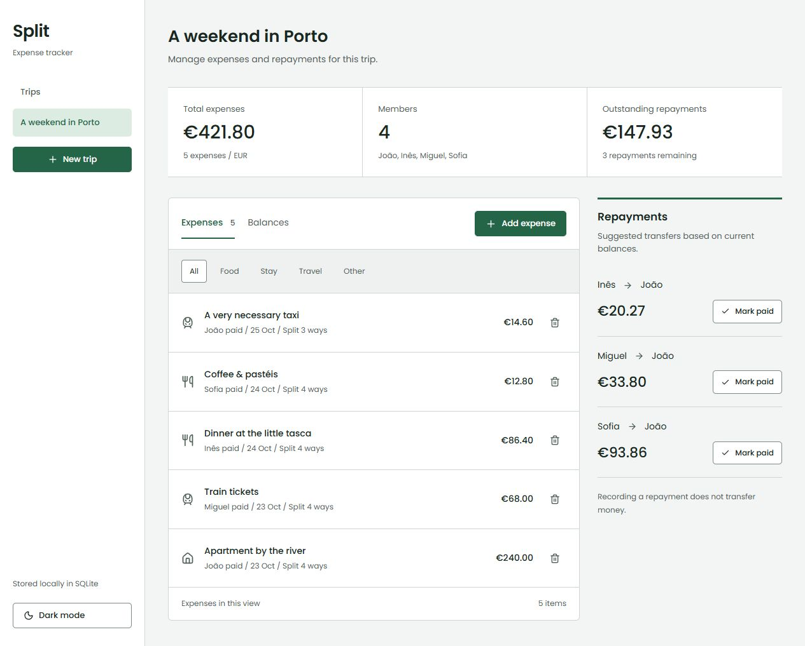
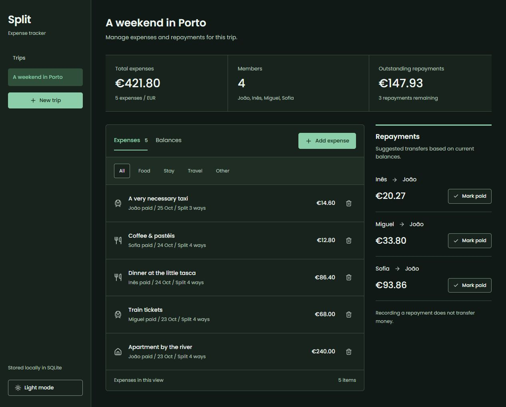

# Split

Shared expenses, balances, and repayments for trips and groups.





## What it does

- Create separate trips with 2–12 people.
- Add expenses, choose who paid, and split between selected participants.
- Browse expenses by category, see individual balances, and remove mistakes.
- Suggest repayments, record them as paid, and undo a recorded payment.
- Keep trips and expenses in a real SQLite database across restarts.

The first run includes a fictional weekend in Porto so there is something useful to explore immediately.

## Run locally

Use Node.js 22.14+ (Node 24 recommended) and npm.

```sh
npm ci
npm run dev
```

Open **http://127.0.0.1:5174**. Vite serves the React app and proxies `/api` to the Node server on port 3001. Node 22 may print an experimental SQLite warning.

```sh
npm test           # domain tests + real HTTP/SQLite integration tests
npm run build     # type-check + production build
npm start         # serve the built app and API together on port 3001
```

The database is created at `data/split.db` and excluded from Git. `SPLIT_DB` overrides the file path; `PORT` overrides the API port (the development proxy expects 3001).

## How it works

React + TypeScript + Vite on the frontend. A small Node HTTP API uses `node:sqlite`, foreign keys, prepared statements, and transactions. There is no mock network layer.

Amounts are integer cents. If €10.01 is divided three ways, the shares are €3.34, €3.34, and €3.33. Remainder cents are assigned in selection order. Repayments use a debtor/creditor matching algorithm; it produces valid settlements, not a guarantee of the mathematically fewest transfers. Stale repayment submissions are rejected.

API routes:

| Method     | Route                                | Purpose                              |
| ---------- | ------------------------------------ | ------------------------------------ |
| GET / POST | `/api/trips`                         | List or create trips                 |
| GET        | `/api/trips/:id`                     | Trip, expenses, balances, repayments |
| POST       | `/api/trips/:id/expenses`            | Add an expense                       |
| DELETE     | `/api/trips/:id/expenses/:expenseId` | Remove an expense                    |
| POST       | `/api/trips/:id/payments`            | Record a suggested repayment         |
| DELETE     | `/api/trips/:id/payments/:paymentId` | Undo a repayment                     |

## Scope

This is a local portfolio app, with EUR and equal splits. It has no authentication or payment processing. “Mark paid” only records that a transfer happened elsewhere. The server binds to loopback; it is not configured as a public multi-user service. A production version would need access control, backups, and per-user trip ownership.

## Design

A trip navigation panel, expense ledger, and separate repayment list. Mobile layouts stack these regions. Poppins is bundled locally. Light and dark themes follow the system preference initially and remember an explicit choice. Dialogs support Escape and controls have visible focus states.

Built by [João Matos](https://github.com/jpndmatos). MIT licensed. Icons by Lucide; Poppins is bundled locally using Fontsource.
