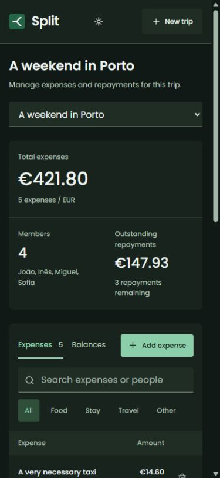

# Split

A shared expense tracker for trips and groups. Add expenses as you go, split them between people, and keep track of repayments.

<picture>
  <source media="(prefers-color-scheme: dark)" srcset="docs/dark.jpg">
  
</picture>

<details>
  <summary>Mobile view</summary>
  <br>
  
</details>

## Features

- Separate trips with their own members and expenses.
- Equal splits between selected people, calculated in cents.
- Expense search, category filters, and individual balances.
- Suggested repayments with payment tracking and undo.
- SQLite storage and light and dark themes.

## Stack

React, TypeScript, Vite, Node.js, and SQLite.

## Run locally

Requires Node.js 22.14 or later.

```sh
npm ci
npm run dev
```

Open [localhost:5174](http://localhost:5174). A sample trip is included on the first run.

```sh
npm test
npm run build
npm start
```

`npm start` serves the production build and API on port 3001. Data is stored in `data/split.db`.
