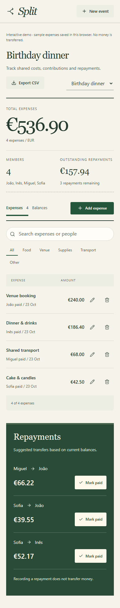

# Split

Split shared event costs between people. Record who paid for the venue, food, supplies or transport, then work out the repayments.


<details>
  <summary>Mobile view</summary>
  <br>
  
</details>

## Features

- Separate events with their own participants and expenses.
- Equal splits between selected people, calculated in cents.
- Expense editing, search, event categories, and individual balances.
- Suggested repayments with payment tracking and undo.
- CSV export, SQLite storage, and a dedicated visual design.

The desktop dashboard keeps the ledger and repayments visible together. Long lists scroll inside their panels.

## Stack

React, TypeScript, Vite, Node.js, and SQLite.

## Run locally

Requires Node.js 22.14 or later.

```sh
npm ci
npm run dev
```

Open [localhost:5174](http://localhost:5174). A sample event is included on the first run.

```sh
npm test
npm run build
npm start
```

`npm start` serves the production build and API on port 3001. Data is stored in `data/split.db`.

## Interface

A warm paper ledger with serif totals, editable expense rows and a separate repayment section. `npm run build:demo` creates `dist-demo`, a labelled browser demo using the same integer-cent money engine as the Node/SQLite API. Production `npm run build` still uses the server.

Each repository builds independently. System fonts keep the initial view free of font downloads.

## Verification

The production build and unit tests pass. Portfolio integration checks cover the main workflows at 390px and 1440px, WCAG A/AA checks including WCAG 2.2 target sizes, and failure handling. The mobile Lighthouse lab result is saved in `docs/performance.json`; it is a local observation, not a field-performance guarantee.
