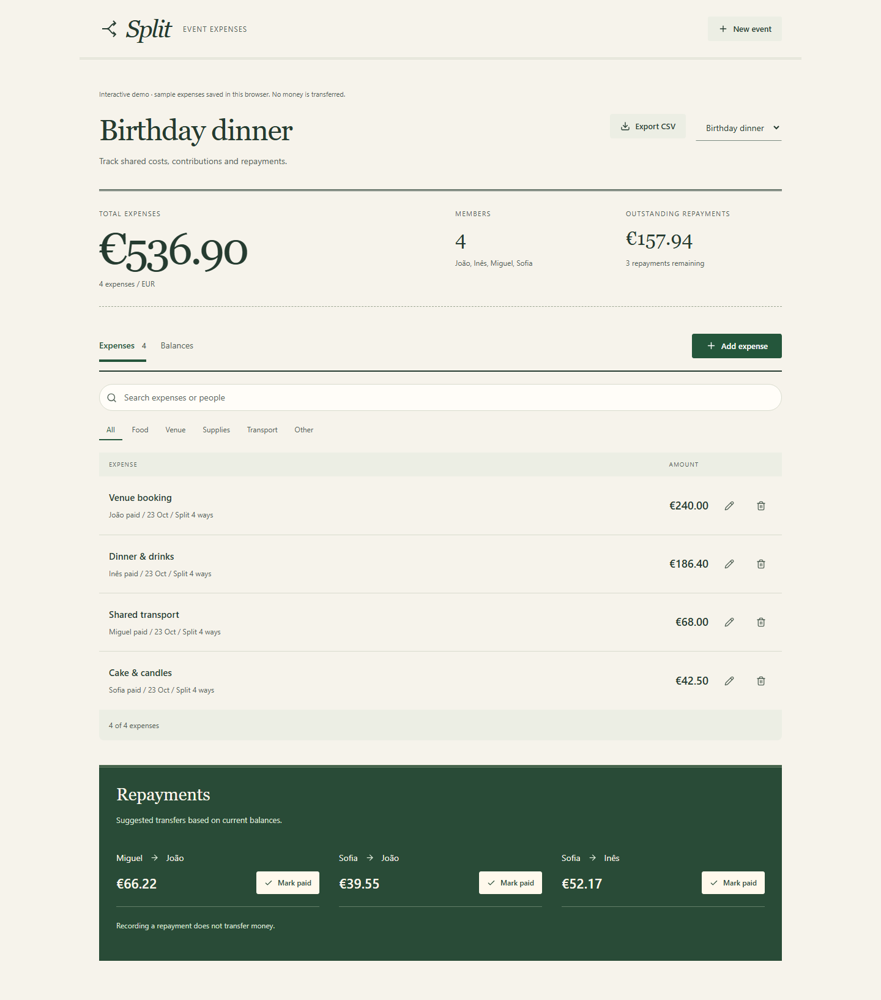

# Split

Split trip and household expenses, see who owes whom, and record repayments. Export expenses or the repayment plan as CSV. Amounts stay accurate to the cent.



## Setup

Node.js 22.14+.

```sh
npm ci
npm run dev
```

Open http://localhost:5174. A sample event is ready on first run; data is stored in `data/split.db`. Repayments are records, not money transfers.
